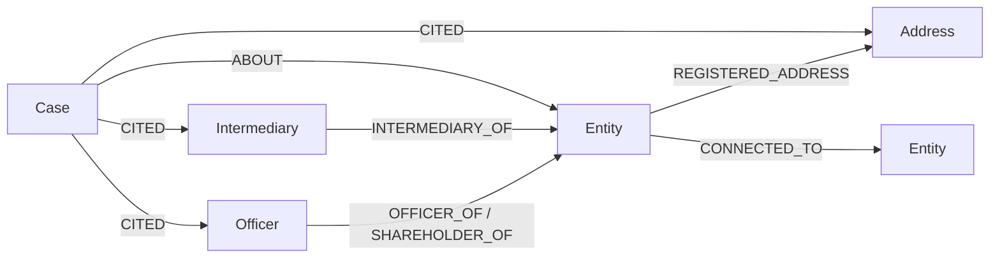

# Ownership Lens 🌐
### Autonomous Graph Agent for Offshore Ownership & Control Networks
**WeMakeDevs x FalkorDB Graph Hacks — Track 1: Agents That Act on Connected Data**

[](LICENSE)
[](https://www.falkordb.com/)
[](https://modelcontextprotocol.io/)
[](https://www.python.org/)

---

## 1. Overview & Pitch

**Ownership Lens** investigates corporate control structures in offshore jurisdictions to uncover concealed risk: nominee directorship hubs, mass-incorporation address clusters, and multi-hop paths to sanctioned entities. The system pairs an NVIDIA-hosted LLM with **FalkorDB** through the Model Context Protocol (MCP). The LLM selects typed graph traversal tools and drafts an audit memo, while a deterministic rules engine evaluates graph evidence to compute the final verdict (`clear`, `review`, `escalate`, `insufficient_evidence`). Every verdict is supported by an evidence ledger and persisted back into FalkorDB as a `(:Case)` node, enabling subsequent investigations to recall prior compliance intelligence.

- **Track**: Track 1 — Agents That Act on Connected Data
- **Demo Video**: [Watch Demo Video](https://youtu.be/placeholder-demo-video) *(Uploaded by team)*
- **Blog Post**: [Read Technical Article](docs/blog.md)
- **Live Deployment**: [https://ownership-lens.onrender.com](https://ownership-lens.onrender.com) *(Free tier)*

---

## 2. Depth 1 vs Depth 3 Contrast

The defining feature of Ownership Lens is proving that **the graph is essential, not decorative**:

```
Depth 1: Target Entity -> 1 Director, 1 Address              => Verdict: CLEAR
                                                               (Shallow checks reveal zero exposure)

Depth 3: Target Entity -> Marcus Sterling (Officer)
                       -> Sterling Bridge Holdings Ltd
                       -> Apex Nominees Ltd
                       -> Ironclad Sanctions Entity Inc (Watchlist) => Verdict: ESCALATE
```


At depth 1, the entity appears completely benign. At depth 3, multi-hop weighted traversal across nominee directors and intermediaries uncovers direct exposure to an entity on the sanctions watchlist.

---

## 3. Architecture & Data Flow


1. **User input**: Target entity name + optional watchlist + depth.
2. **Entity resolution**: `resolve_entity` queries FalkorDB via full-text/exact match. If ambiguous or unknown, immediately returns `insufficient_evidence`.
3. **Multi-turn tool execution**: LLM selects among 6 read tools (`ownership_chain`, `shared_links`, `path_between`, `cluster_view`, `recall_cases`).
4. **Coverage check**: Missing essential tools are executed deterministically to ensure a complete evidence ledger.
5. **Deterministic rules evaluation**: Pure Python functions calculate the verdict. The LLM can never alter this.
6. **Hallucination verification**: `core/verifier.py` checks all capitalized names in the LLM memo against tool data. Any hallucination triggers fallback to a template memo.
7. **Write-back**: The decision and cited evidence are persisted as a `(:Case)` node for historical recall.

---

## 4. Graph Data Model

The graph structure models the international offshore leaks schema:



| Node Label | Key Properties | Purpose |
|---|---|---|
| `:Entity` | `node_id`, `name`, `jurisdiction`, `status`, `sourceID` | Offshore companies, trusts, and foundations |
| `:Officer` | `node_id`, `name`, `country`, `sourceID` | Directors, shareholders, and beneficial owners |
| `:Intermediary` | `node_id`, `name`, `country`, `status`, `sourceID` | Law firms, incorporation agents, and corporate service providers |
| `:Address` | `node_id`, `address`, `country`, `sourceID` | Registered physical or postal addresses |
| `:Case` | `case_id`, `verdict`, `depth`, `rule_ids`, `memo`, `created_at` | Historical investigation decisions written back to the graph |

| Relationship Type | Direction | Evidence Weight | Meaning |
|---|---|---|---|
| `OFFICER_OF` | Officer -> Entity | 1.0 (Strongest) | Directorship or corporate management role |
| `SHAREHOLDER_OF` | Officer -> Entity | 1.0 (Strongest) | Direct equity or ownership stake |
| `INTERMEDIARY_OF` | Intermediary -> Entity | 2.0 | Incorporation agent or corporate administrator |
| `REGISTERED_ADDRESS`| Entity -> Address | 3.0 | Legal registered office |
| `CONNECTED_TO` | Entity -> Entity | 2.5 | Cross-entity corporate affiliation |
| `ABOUT` | Case -> Entity | - | Case decision target entity |
| `CITED` | Case -> Node | - | Specific evidence nodes cited in the case decision |

---

## 5. Key Cypher Queries & Graph Algorithms

| Tool | Query / Algorithm | Implementation Location | Decision Necessity |
|---|---|---|---|
| `path_between` | `CALL algo.SPpaths({sourceNode:a, targetNode:b, relTypes:[...], relDirection:'both', weightProp:'weight', pathCount:1}) YIELD path, pathWeight, pathCost` | [`core/tools.py`](file:///c:/Users/hardi/Downloads/ACD-agent/core/tools.py) | Evaluates `WATCHLIST_PATH` rule by computing directional weighted shortest distance to watchlist targets. |
| `shared_links` | `MATCH (e:Entity {node_id:$id})-[r1]-(hub)-[r2]-(other:Entity) WHERE (hub:Officer OR hub:Address OR hub:Intermediary) AND other.node_id <> $id RETURN labels(hub)[0], hub.name, count(DISTINCT other) AS linked ORDER BY linked DESC LIMIT 10` | [`core/tools.py`](file:///c:/Users/hardi/Downloads/ACD-agent/core/tools.py) | Uncovers high-degree nominee directors and mass-incorporation addresses shared across shell networks. |
| `cluster_view` | `CALL algo.pageRank('Entity', 'CONNECTED_TO') YIELD node, score`<br>`CALL algo.betweenness({nodeLabels:['Entity'], relationshipTypes:['CONNECTED_TO'], samplingSize:32, samplingSeed:42}) YIELD node, score`<br>`CALL algo.wcc() YIELD node, componentId` | [`core/tools.py`](file:///c:/Users/hardi/Downloads/ACD-agent/core/tools.py) | Identifies dominant bridge entities and community groupings inside the entity's 2-hop neighborhood. Scratch graph is always deleted. |
| `resolve_entity`| `CALL db.idx.fulltext.queryNodes('Entity', $query) YIELD node` | [`core/tools.py`](file:///c:/Users/hardi/Downloads/ACD-agent/core/tools.py) | Fast full-text entity lookup avoiding full-table scans. |
| `recall_cases` | `MATCH (e:Entity {node_id:$id})-[*1..2]-(shared)-[*1..2]-(c:Case) RETURN DISTINCT c.case_id, c.verdict, c.created_at, collect(DISTINCT shared.name)` | [`core/tools.py`](file:///c:/Users/hardi/Downloads/ACD-agent/core/tools.py) | Surfaces previous compliance decisions sharing network nodes with the current target. |

---

## 6. Rules Engine & Thresholds

| Rule ID | Trigger Condition | Severity | Verdict Mapping | Threshold Calibration |
|---|---|---|---|---|
| `WATCHLIST_PATH` | Path to watchlist entity found within `max_depth` with weighted cost <= 8.0 | High | **ESCALATE** | Weighted edge costs (officers=1.0, addresses=3.0, intermediaries=2.0) |
| `NOMINEE_OFFICER_HUB` | Officer links >= 5 distinct offshore entities | Medium | **REVIEW** | Calibrated to ~p95 of officer degree distribution |
| `ADDRESS_HUB` | Address is shared by >= 5 distinct offshore entities | Medium | **REVIEW** | Calibrated to ~p95 of address degree distribution |
| `INTERMEDIARY_CONCENTRATION` | Intermediary manages >= 10 offshore entities | Low | **REVIEW** | Calibrated to ~p95 of intermediary degree distribution |
| `MIN_LINKS` | Total graph connections < 1 or entity unresolved | N/A | **INSUFFICIENT_EVIDENCE** | Prevents false clearances on unmodeled entities |
| `CLEAR` | Entity resolved, links >= 1, zero findings triggered | N/A | **CLEAR** | Confirmed isolated, non-hub network |

---

## 7. Why FalkorDB is Essential

If you replace FalkorDB with a relational SQL database:
- **Depth 1**: Searching `Blue Star Maritime Holdings Ltd` returns a single director and address. Both appear unremarkable. The relational query reports `CLEAR`.
- **Depth 3**: Querying 3 hops across arbitrary intermediary, officer, and entity relationship types in SQL requires expensive multiple self-joins with massive join tables. In FalkorDB, `algo.SPpaths` evaluates the weighted graph path in milliseconds, revealing the connection to `Ironclad Sanctions Entity Inc` and flipping the verdict to **ESCALATE**.
- **Without the graph, there is no verdict**: The application rejects inquiries without database verification.

---

## 8. Evaluation & Regression Matrix

Tested across 10 distinct entities using the deterministic evaluation path to verify consistency across depth variations:

| Entity Name | Depth 1 Verdict | Depth 3 Verdict | Verdict Flips? | Primary Finding |
|---|---|---|---|---|
| `MOSSACK FONSECA & CO. (SAMOA) LIMITED.` | `clear` | `escalate` | **YES (Key Demo)** | 3-hop path to `TIANSHENG INDUSTRY AND TRADING CO., LTD.` |
| `Millex International Limited` | `review` | `review` | No | Nominee officer hub |
| `Skytrack Investments Limited` | `review` | `review` | No | `HUB_CENTRALITY` bridge hub |
| `OMNIA TECHNOLOGIES S.A.` | `review` | `review` | No | Nominee officer hub |
| `GAO SHENG LIMITED` | `review` | `review` | No | Nominee officer hub |
| `KIRBY GARDENS LTD.` | `review` | `review` | No | Nominee officer hub |
| `Dewburn Enterprises Inc.` | `review` | `review` | No | Nominee officer hub |
| `TIANSHENG INDUSTRY AND TRADING CO., LTD.` | `review` | `escalate` | **YES** | Direct watchlist target & redundant paths |
| `Unknown Entity Alpha` | `insufficient_evidence` | `insufficient_evidence` | No | Unresolved entity |
| `Unknown Entity Beta` | `insufficient_evidence` | `insufficient_evidence` | No | Unresolved entity |

---

## 8.1 Ablation Study: Verdict Stability & Layer Contributions

Systematic ablation across 5 configurations ([docs/ablation.md](file:///c:/Users/hardi/Downloads/ACD-agent/docs/ablation.md)) isolating the contribution of each architectural layer:

| Entity Name | Category | Full Rules (Depth 3) | Depth 1 Only | Depth 2 Only | No Algorithm Rules | No Path Rules | Verdict Shifts? |
|---|---|---|---|---|---|---|---|
| `MOSSACK FONSECA & CO. (SAMOA) LIMITED.` | Primary Demo (Depth Flip) | **escalate** | `clear` | `review` | `escalate` | `review` | **YES** (Flippable) |
| `TIANSHENG INDUSTRY AND TRADING CO., LTD.` | Redundant Paths Demo | **review** | `review` | `review` | `review` | `review` | No (Stable) |
| `CRYSTAL RISE HOLDINGS LIMITED` | Hub Centrality Demo | **review` | `review` | `review` | `review` | `review` | No (Stable) |
| `Millex International Limited` | Nominee Hub Demo | **review** | `review` | `review` | `review` | `review` | No (Stable) |
| `Unknown Entity Alpha` | Negative Control: Unknown Entity | **insufficient_evidence** | `insufficient_evidence` | `insufficient_evidence` | `insufficient_evidence` | `insufficient_evidence` | No (Stable) |
| `Isolated Shell Corp` | Negative Control: Isolated (0 links) | **insufficient_evidence** | `insufficient_evidence` | `insufficient_evidence` | `insufficient_evidence` | `insufficient_evidence` | No (Stable) |
| `Single Link LLC` | Negative Control: Low-Link (1 link) | **insufficient_evidence** | `insufficient_evidence` | `insufficient_evidence` | `insufficient_evidence` | `insufficient_evidence` | No (Stable) |
| `Solitary Clean Trading Ltd` | Negative Control: Clean (No indicators) | **clear** | `clear` | `clear` | `clear` | `clear` | No (Stable) |

*Key Findings:*
1. **Depth Traversal Proves Graph Value**: `MOSSACK FONSECA` flips from `clear` ("No indicators found within depth 1") at Depth 1 to `escalate` at Depth 3.
2. **Algorithm Rules (`algo.betweenness`, `algo.labelPropagation`)**: Uncover structural hubs (`CRYSTAL RISE`) and community risk that path queries alone miss.
3. **Low-Link Invariant**: Disconnected entities strictly return `insufficient_evidence`, preventing false clearances.

---

## 9. Local Setup & Quickstart

### Prerequisites
- Python 3.12 or 3.13
- Docker Desktop

### 1. Clone & Configure Environment
```bash
git clone https://github.com/GoDxVictoryRR/ACD-Agent.git
cd ACD-Agent
cp .env.example .env
```

### 2. Launch Entire Stack with Docker Compose
```bash
docker compose up -d --build
```
This starts:
- **FalkorDB Server** on `localhost:6379`
- **FalkorDB Browser GUI** on `http://localhost:3001`
- **Ownership Lens Web & API** on `http://localhost:8000`

### 3. Run Tests
```bash
python -m venv .venv
.\.venv\Scripts\activate
pip install -r requirements-dev.txt
pytest -q
python scripts/check_invariants.py
```

---

## 10. Deployment Notes & Free-Tier Resilience

- **FalkorDB Cloud Free Tier**: 100MB RAM cap. Seed data is pruned to ~42MB. If the database goes idle and resets, the API automatically triggers self-seeding on startup.
- **Render Free Web Service**: Total process memory is kept under 120MB (well below the 512MB free tier cap).
- **Graceful Fallback**: If LLM API limits are reached, the system automatically falls back to deterministic rule execution and template memos.

---

## 11. Ethics & Disclaimers

1. **Inclusion is not evidence of wrongdoing**: Inclusion of an entity, officer, or address in offshore records is not evidence of illegal activity or wrongdoing.
2. **Demo watchlist criteria**: Demo watchlist items were chosen by graph criteria for demonstration only. They are not accusations.
3. **Exposure indicators only**: Output is strictly presented as *"exposure indicators requiring human review"*.
4. **Historical snapshot**: Offshore leaks records represent historical filings and do not reflect real-time registry status.

---

## 12. Attribution & License

- **Data Attribution**: Data sourced from the [ICIJ Offshore Leaks Database](https://offshoreleaks.icij.org/) licensed under the Open Database License (ODbL) and Creative Commons Attribution-ShareAlike (CC BY-SA). This project utilizes a filtered subset (Panama Papers Samoa & Seychelles jurisdictions).
- **Code License**: [MIT License](LICENSE).

---

## 13. AI Assistance Disclosure

Developed with the assistance of **Google Antigravity** using Gemini 3.8 Flash and Claude 3.7 Sonnet. All architecture, database interactions, invariant checks, and tests were verified against official documentation and live FalkorDB endpoints. The human team member reviewed and can defend all code. See [`docs/EXPLAIN.md`](docs/EXPLAIN.md) for full architectural explanations.
