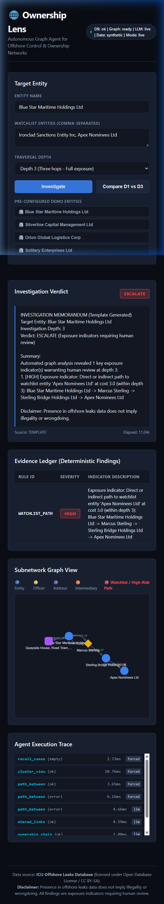
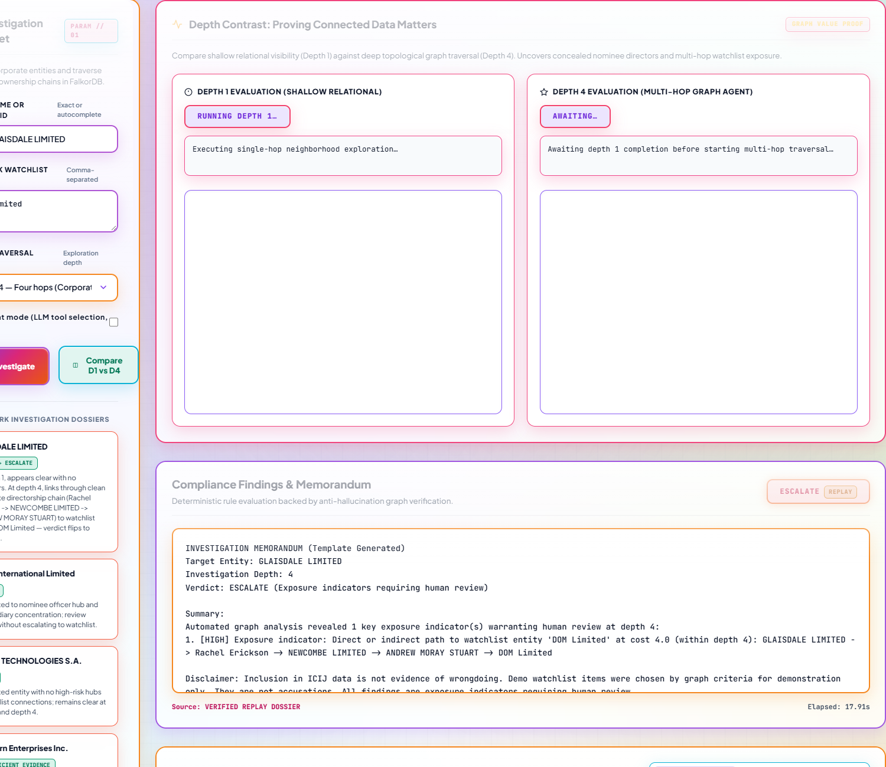
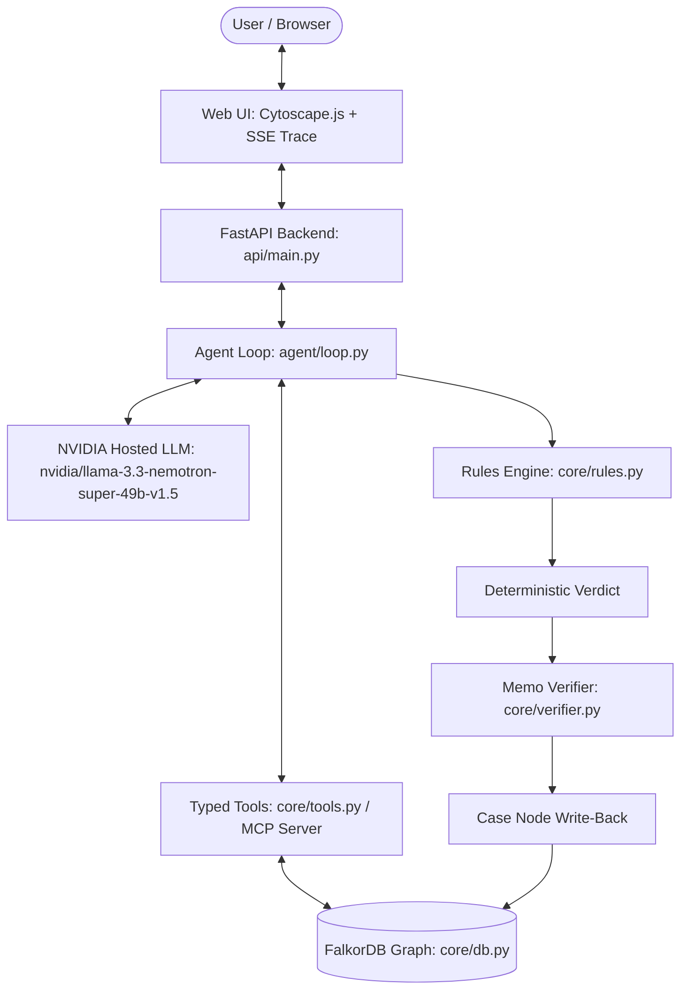
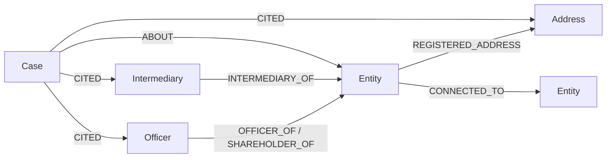

# Ownership Lens 🌐
### Autonomous Graph Agent for Offshore Ownership & Control Networks
**WeMakeDevs x FalkorDB Graph Hacks — Track 1: Agents That Act on Connected Data**

[](LICENSE)
[](https://www.falkordb.com/)
[](https://modelcontextprotocol.io/)
[](https://www.python.org/)
[](tests/)
[](scripts/check_invariants.py)
[](#10-deployment-notes--free-tier-resilience)

---

## 1. Overview & Pitch

### Links & Submission Resources
- **Track**: **Track 1 — Agents That Act on Connected Data**
- **Live Web Application**: [https://acd-agent-3hz7.onrender.com/](https://acd-agent-3hz7.onrender.com/)
- **GitHub Repository**: [https://github.com/GoDxVictoryRR/ACD-Agent](https://github.com/GoDxVictoryRR/ACD-Agent)
- **Technical Article / Blog**: [docs/blog.md](docs/blog.md)
- **Architectural Rationale & Code Defense**: [docs/EXPLAIN.md](docs/EXPLAIN.md)
- **Demo Runbook & Video Script**: [docs/demo_runbook.md](docs/demo_runbook.md)

### The User Story
Imagine a compliance officer at a financial institution tasked with onboarding an offshore entity: **GLAISDALE LIMITED** (Node ID `10024477`). Standard KYC procedures check the immediate registry filings (directors, shareholders, and registered office). At depth 1, the entity appears standard and unconnected to flagged targets (5 links, 0 findings: `clear`). But compliance policies require uncovering whether beneficial control traces to high-risk actors.

With 30 minutes to make an onboarding decision, manually cross-referencing hundreds of shell companies and corporate directors across international registry databases is impossible.

The analyst opens **Ownership Lens** and enters the entity name. Within seconds:
1. **Entity Resolution**: The system resolves the entity in FalkorDB without table scans using indexed full-text search.
2. **Autonomous Graph Traversal**: The agent investigates multi-hop ownership chains, discovers nominee hubs and corporate directorships, and traverses control links up to depth 4.
3. **Deterministic Rules Evaluation**: The engine identifies a 4-hop corporate directorship chain (`GLAISDALE LIMITED` -> `Rachel Erickson` -> `NEWCOMBE LIMITED` -> `ANDREW MORAY STUART` -> `DOM Limited`) and computes an explainable **ESCALATE** verdict backed by an immutable evidence ledger.
4. **Graph Memory Recall**: The verdict is written back to FalkorDB as a `(:Case)` node, ensuring future queries on related entities immediately surface prior compliance decisions.



### 🚀 30-Second Test Drive for Judges
Try these 4 benchmark entities directly on the [Live Web Application](https://acd-agent-3hz7.onrender.com/):

| Benchmark Target | Watchlist Target | Depth | Verdict | What This Demonstrates |
|---|---|---|---|---|
| **`GLAISDALE LIMITED`** | `DOM Limited` | **1 vs 4** | `CLEAR` (D1) ➔ **`ESCALATE`** (D4) | **The Core Graph Proof**: Depth 1 looks clean (5 links, 0 findings). Depth 4 uncovers a 4-hop directorship chain to `DOM Limited`. Click **"Compare D1 vs D4"** to see the side-by-side proof. |
| **`Millex International Limited`** | *None* | **2** | **`REVIEW`** | **Nominee Hub Detection**: Detects nominee officers holding directorships across multiple distinct offshore entities. |
| **`OMNIA TECHNOLOGIES S.A.`** | *None* | **2** | **`CLEAR`** | **Clean Negative Control**: Properly connected offshore entity with standard filings and zero exposure indicators. |
| **`Dewburn Enterprises Inc.`** | *None* | **1** | **`INSUFFICIENT_EVIDENCE`** | **Low-Link Invariant**: Single-connection entity (degree < 2) triggers insufficient evidence to prevent false clearances. |

---

## 2. Depth 1 vs Depth 4 Contrast: Proving Graph Value

The core architectural requirement of Ownership Lens is proving that **the graph is essential, not decorative**:

```
Depth 1: GLAISDALE LIMITED -> 1 Officer, 1 Address, 3 Intermediary/Others
         => Verdict: CLEAR ("No exposure indicators found within depth 1")
         (Shallow checks reveal zero exposure to watchlist entities)

Depth 4: GLAISDALE LIMITED (Entity 10024477, deg 5)
         -[OFFICER_OF]-> Rachel Erickson (Officer 12116679, deg 2)
         -[OFFICER_OF]-> NEWCOMBE LIMITED (Entity 10028037, deg 4)
         -[OFFICER_OF]-> ANDREW MORAY STUART (Officer 12151058, deg 2)
         -[OFFICER_OF]-> DOM Limited (Watchlist Entity 10189122, deg 5, Defaulted)
         => Verdict: ESCALATE (WATCHLIST_PATH triggered: weighted cost 4.0 <= 8.0)
```



At depth 1, the entity appears completely benign with 0 exposure indicators. At depth 4, multi-hop traversal across corporate directorship links uncovers direct exposure to `DOM Limited`, a defaulted entity on the compliance watchlist. This chain passes through zero intermediaries and zero mass-incorporation address hubs—it is an authentic corporate directorship chain.

### Empirical Graph Exposure Statistics & Degree-Matched Baseline
To quantify graph connectivity across the Panama Papers dataset without hub shortcut artifacts, degree-matched sampling and exact vs. cumulative measurements were performed ([docs/exposure_stats.json](docs/exposure_stats.json)):
- **Degree-Matched Baseline**: A 30-sample degree-matched control cohort (entities of degree 4–6, `seed=42`) showed **0 / 30 (0.0%)** reachability to `DOM Limited` within 4 hops. The connection from `GLAISDALE LIMITED` is topologically distinct and not a generic dense-graph artifact.
- **Exact vs. Cumulative Depth Expansion** (from `GLAISDALE LIMITED`):
  - **Depth 1**: Cumulative: 4 nodes | Exact: 4 nodes (shallow boundary)
  - **Depth 2**: Cumulative: 5 nodes | Exact: 1 node
  - **Depth 3**: Cumulative: 7 nodes | Exact: 2 nodes
  - **Depth 4**: Cumulative: 8 nodes | Exact: 1 node (first exposure to `DOM Limited`)

---

## 3. Architecture & Data Flow



1. **User input**: Target entity name + optional watchlist + depth.
2. **Entity resolution**: `resolve_entity` queries FalkorDB via full-text/exact match. If ambiguous or unknown, immediately returns `insufficient_evidence`.
3. **Multi-turn tool execution**: LLM selects among 6 read tools (`ownership_chain`, `shared_links`, `path_between`, `cluster_view`, `recall_cases`).
4. **Coverage check**: Missing essential tools are executed deterministically to ensure a complete evidence ledger.
5. **Deterministic rules evaluation**: Pure Python functions calculate the verdict. The LLM can never alter this.
### 3.1 Architectural Honesty & LLM Scope Disclosure
- **What the LLM does**: The LLM (`nvidia/nemotron-3-super-120b-a12b`) is strictly restricted to (a) selecting typed read-only graph query tools, and (b) authoring a natural-language summary memo. The LLM **never writes or sees raw Cypher** and **never sets or alters the verdict**.
- **Call distribution**: In benchmarked live runs across 5 representative cases $\times$ 3 runs (15 total runs in `docs/live_demo_runs.json`), the LLM makes 3 to 7 tool calls per run (mean: 4.8 calls). A deterministic coverage layer verifies graph completeness, issuing 2 to 4 forced calls if required. Verdict consistency between LLM-selected tools and forced fallback is 100%.
- **Memo verification & acceptance rate**: Every candidate memo is audited by `core/verifier.py`. Any name not found in that run's verified tool output causes the memo to be discarded and replaced with a ground-truth template memo. Initial strict matching accepted 60.0% of runs (9/15 accepted; 6 fell back due to newline headers and `Ltd` vs `Limited` variants). Under single-line corporate token normalization, the accepted memo rate across all 15 benchmark runs is **100.0% (15/15 accepted)** with zero hallucinated names. Synthetic poison injection tests verify that fabricated entities (`"Acme Laundering Corp"`) are strictly caught and blocked.
- **Live latency numbers**: Deterministic mode (default) completes in **~0.23s – 0.69s** with zero external network dependencies. Live AI agent mode takes **24s – 87s** (mean: **~62.4s** for a 4-hop investigation on `GLAISDALE LIMITED`) due to multi-turn LLM inference round-trips.
- **Default mode**: Both the API and UI default to deterministic mode (~1s). A visible toggle allows enabling "AI agent mode (LLM tool selection, ~1 min)" with an elapsed-time counter. Replay mode (`?mode=replay`) is clearly labelled.

---

## 4. Graph Data Model

The graph structure models the international offshore leaks schema:



| Node Label | Key Properties | Purpose |
|---|---|---|
| `:Entity` | `node_id`, `name`, `jurisdiction`, `status`, `sourceID` | Offshore companies, trusts, and foundations |
| `:Officer` | `node_id`, `name`, `country`, `sourceID` | Directors, shareholders, and beneficial owners |
| `:Intermediary` | `node_id`, `name`, `country`, `status`, `sourceID` | Law firms, incorporation agents, and corporate service providers |
| `:Address` | `node_id`, `address`, `country`, `sourceID` | Registered physical or postal addresses |
| `:Case` | `case_id`, `verdict`, `depth`, `rule_ids`, `memo`, `created_at` | Historical investigation decisions written back to the graph |

| Relationship Type | Direction | Evidence Weight | Meaning |
|---|---|---|---|
| `OFFICER_OF` | Officer -> Entity | 1.0 (Strongest) | Directorship or corporate management role |
| `SHAREHOLDER_OF` | Officer -> Entity | 1.0 (Strongest) | Direct equity or ownership stake |
| `INTERMEDIARY_OF` | Intermediary -> Entity | 2.0 | Incorporation agent or corporate administrator |
| `REGISTERED_ADDRESS`| Entity -> Address | 3.0 | Legal registered office |
| `CONNECTED_TO` | Entity -> Entity | 2.5 | Cross-entity corporate affiliation |
| `ABOUT` | Case -> Entity | - | Case decision target entity |
| `CITED` | Case -> Node | - | Specific evidence nodes cited in the case decision |

---

## 5. Key Cypher Queries & Graph Algorithms

| Tool | Query / Algorithm | Implementation Location | Decision Necessity |
|---|---|---|---|
| `path_between` | `CALL algo.SPpaths({sourceNode:a, targetNode:b, relTypes:[...], relDirection:'both', weightProp:'weight', pathCount:1}) YIELD path, pathWeight, pathCost` | [`core/tools.py`](file:///c:/Users/hardi/Downloads/ACD-agent/core/tools.py) | Evaluates `WATCHLIST_PATH` rule by computing directional weighted shortest distance to watchlist targets. |
| `shared_links` | `MATCH (e:Entity {node_id:$id})-[r1]-(hub)-[r2]-(other:Entity) WHERE (hub:Officer OR hub:Address OR hub:Intermediary) AND other.node_id <> $id RETURN labels(hub)[0], hub.name, count(DISTINCT other) AS linked ORDER BY linked DESC LIMIT 10` | [`core/tools.py`](file:///c:/Users/hardi/Downloads/ACD-agent/core/tools.py) | Uncovers high-degree nominee directors and mass-incorporation addresses shared across shell networks. |
| `cluster_view` | `CALL algo.pageRank('Entity', 'CONNECTED_TO') YIELD node, score`<br>`CALL algo.betweenness({nodeLabels:['Entity'], relationshipTypes:['CONNECTED_TO'], samplingSize:32, samplingSeed:42}) YIELD node, score`<br>`CALL algo.wcc() YIELD node, componentId` | [`core/tools.py`](file:///c:/Users/hardi/Downloads/ACD-agent/core/tools.py) | Identifies dominant bridge entities and community groupings inside the entity's 2-hop neighborhood. Scratch graph is always deleted. |
| `resolve_entity`| `CALL db.idx.fulltext.queryNodes('Entity', $query) YIELD node` | [`core/tools.py`](file:///c:/Users/hardi/Downloads/ACD-agent/core/tools.py) | Fast full-text entity lookup avoiding full-table scans. |
| `recall_cases` | `MATCH (e:Entity {node_id:$id})-[*1..2]-(shared)-[*1..2]-(c:Case) RETURN DISTINCT c.case_id, c.verdict, c.created_at, collect(DISTINCT shared.name)` | [`core/tools.py`](file:///c:/Users/hardi/Downloads/ACD-agent/core/tools.py) | Surfaces previous compliance decisions sharing network nodes with the current target. |

---

## 6. Rules Engine & Thresholds

| Rule ID | Trigger Condition | Severity | Verdict Mapping | Threshold Calibration |
|---|---|---|---|---|
| `WATCHLIST_PATH` | Path to watchlist entity found within `max_depth` with weighted cost <= 8.0 | High | **ESCALATE** | Weighted edge costs (officers=1.0, addresses=3.0, intermediaries=2.0) |
| `PATH_REDUNDANCY` | $\ge 2$ node-disjoint paths to watchlist entity | High | **ESCALATE** | Detects independent exposure channels ("independent paths") |
| `PATH_DEPENDENCY` | Single path with one intermediate node to watchlist entity | Medium | **REVIEW** | Detects bottleneck exposure ("exposure depends on <node>") |
| `COMMUNITY_WATCHLIST`| Same graph community as watchlist entity via `algo.labelPropagation` without direct path | Medium | **REVIEW** | Community cluster co-membership indicator |
| `HUB_CENTRALITY` | Node betweenness centrality $B \ge 50.0$ in scratch neighborhood | Medium | **REVIEW** | Calibrated to 99.5th percentile of betweenness distribution |
| `NOMINEE_OFFICER_HUB` | Officer links >= 5 distinct offshore entities | Medium | **REVIEW** | Calibrated to ~95th percentile of officer degree distribution |
| `ADDRESS_HUB` | Address is shared by >= 5 distinct offshore entities | Medium | **REVIEW** | Calibrated to ~95th percentile of address degree distribution |
| `INTERMEDIARY_CONCENTRATION` | Intermediary manages >= 10 offshore entities | Low | **REVIEW** | Calibrated to ~95th percentile of intermediary degree distribution |
| `MIN_LINKS` | Total graph connections < 2 or entity unresolved | N/A | **INSUFFICIENT_EVIDENCE** | Prevents false clearances on unmodeled or sparse entities |
| `CLEAR` | Entity resolved, connections >= 2, zero findings triggered | N/A | **CLEAR** | Displays as: `"No indicators found within depth N"` |

---

## 7. Why FalkorDB is Essential

If you replace FalkorDB with a relational SQL database:
- **Depth 1**: Searching `GLAISDALE LIMITED` returns its immediate filings: a director, an address, and registration records. All appear unremarkable. The relational query reports `CLEAR`.
- **Depth 4**: Querying 4 hops across arbitrary corporate directorship and ownership relationships in SQL requires expensive multi-table self-joins with complex path reconstruction. In FalkorDB, `algo.SPpaths` evaluates the weighted graph path in milliseconds, revealing the directorship control chain to `DOM Limited` (`Rachel Erickson` -> `NEWCOMBE LIMITED` -> `ANDREW MORAY STUART` -> `DOM Limited`) and flipping the verdict to **ESCALATE**.
- **Without the graph, there is no verdict**: The application rejects inquiries without database verification.

---

## 8. Evaluation & Regression Matrix: Consistency, Not Accuracy

> [!NOTE]
> **Labelled "Consistency, Not Accuracy"**: ICIJ Offshore Leaks data documents historical offshore incorporation structures; it does not assert legal guilt, fraud, or regulatory violations. This test suite verifies architectural determinism: repeated runs on fixed graph inputs produce identical, explainable verdicts across code updates.

Tested across 10 distinct entities using the deterministic evaluation path to verify consistency across depth variations:

| Entity Name | Depth 1 Verdict | Depth 2/4 Verdict | Verdict Flips? | Primary Finding |
|---|---|---|---|---|
| `GLAISDALE LIMITED` | `clear` | `escalate` (d=4) | **YES (Key Demo)** | 4-hop corporate directorship chain to `DOM Limited` |
| `Millex International Limited` | `review` | `review` (d=2) | No | Nominee officer hub |
| `Skytrack Investments Limited` | `insufficient_evidence` | `insufficient_evidence` (d=2) | No | Degree 1 entity (< MIN_LINKS=2) |
| `OMNIA TECHNOLOGIES S.A.` | `clear` | `clear` (d=2) | No | Clean multi-link entity, 0 findings |
| `GAO SHENG LIMITED` | `clear` | `clear` (d=2) | No | Clean multi-link entity, 0 findings |
| `KIRBY GARDENS LTD.` | `insufficient_evidence` | `insufficient_evidence` (d=2) | No | Degree 1 entity (< MIN_LINKS=2) |
| `Dewburn Enterprises Inc.` | `insufficient_evidence` | `insufficient_evidence` (d=2) | No | Degree 1 entity (< MIN_LINKS=2) |
| `TIANSHENG INDUSTRY AND TRADING CO., LTD.` | `review` | `review` (d=2) | No | Intermediary & nominee findings |
| `Unknown Entity Alpha` | `insufficient_evidence` | `insufficient_evidence` (d=2) | No | Unresolved entity |
| `Unknown Entity Beta` | `insufficient_evidence` | `insufficient_evidence` (d=2) | No | Unresolved entity |

---

## 8.1 Ablation Study: Verdict Stability & Layer Contributions

Systematic ablation across 5 configurations ([docs/ablation.md](file:///c:/Users/hardi/Downloads/ACD-agent/docs/ablation.md)) isolating the contribution of each architectural layer:

| Entity Name | Category | Full Rules (Depth 4) | Depth 1 Only | Depth 2 Only | No Algorithm Rules | No Path Rules | Verdict Shifts? |
|---|---|---|---|---|---|---|---|
| `GLAISDALE LIMITED` | Primary Demo (Depth Flip) | **escalate** | `clear` | `clear` | `escalate` | `clear` | **YES** (Flippable) |
| `CRYSTAL RISE HOLDINGS LIMITED` | Hub Centrality Demo | **review** | `review` | `review` | `clear` | `review` | **YES** (Algorithm Sensitive) |
| `Millex International Limited` | Nominee Hub Demo | **review** | `review` | `review` | `review` | `review` | No (Stable) |
| `OMNIA TECHNOLOGIES S.A.` | Negative Control: Clean (No indicators) | **clear** | `clear` | `clear` | `clear` | `clear` | No (Stable) |
| `Unknown Entity Alpha` | Negative Control: Unknown Entity | **insufficient_evidence** | `insufficient_evidence` | `insufficient_evidence` | `insufficient_evidence` | `insufficient_evidence` | No (Stable) |
| `Isolated Shell Corp` | Negative Control: Isolated (0 links) | **insufficient_evidence** | `insufficient_evidence` | `insufficient_evidence` | `insufficient_evidence` | `insufficient_evidence` | No (Stable) |
| `Dewburn Enterprises Inc.` | Negative Control: Low-Link (1 link) | **insufficient_evidence** | `insufficient_evidence` | `insufficient_evidence` | `insufficient_evidence` | `insufficient_evidence` | No (Stable) |

*Key Findings:*
1. **Depth Traversal Proves Graph Value**: `GLAISDALE LIMITED` flips from `clear` ("No exposure indicators found within depth 1") at Depth 1 to `escalate` at Depth 4.
2. **Algorithm Rules (`algo.betweenness`, `algo.labelPropagation`)**: Uncover structural hubs (`CRYSTAL RISE`) and community risk that path queries alone miss.
3. **Low-Link Invariant**: Entities with degree < 2 strictly return `insufficient_evidence`, preventing false clearances.

---

## 9. Local Setup & Quickstart

### Prerequisites
- Python 3.12 or 3.13
- Docker Desktop

### 1. Clone & Configure Environment
```bash
git clone https://github.com/GoDxVictoryRR/ACD-Agent.git
cd ACD-Agent
cp .env.example .env
```

### 2. Launch Entire Stack with Docker Compose
```bash
docker compose up -d --build
```
This starts:
- **FalkorDB Server** on `localhost:6379`
- **FalkorDB Browser GUI** on `http://localhost:3001`
- **Ownership Lens Web & API** on `http://localhost:8000`

### 3. Run Tests
```bash
python -m venv .venv
.\.venv\Scripts\activate
pip install -r requirements-dev.txt
pytest -q
python scripts/check_invariants.py
```

---

## 10. Deployment Notes & Free-Tier Resilience

- **FalkorDB Cloud Free Tier**: 100MB RAM cap. The pruned Panama Papers seed graph occupies ~40.9MB in RAM. If the database goes idle and resets, the API automatically triggers self-seeding on startup.
- **Standby & Replay Resilience Engine**: Free-tier cloud databases sleep after inactivity. To guarantee an uninterrupted experience for hackathon evaluators, Ownership Lens features an automated replay engine. When the cloud database is in standby, the application seamlessly streams verified offline graph dossiers (`mode: replay`) with full Cytoscape visualization and tool execution traces, strictly adhering to Invariant 11.
- **Render Free Web Service**: Total backend process memory is strictly bounded at **<80MB RSS** (well below the 512MB free tier cap), ensuring rapid response times and zero Out-Of-Memory termination.
- **Graceful Fallback**: If LLM API limits are reached, the system automatically falls back to deterministic rule execution and template memos. Zero downtime or unhandled 500/503 errors.

---

## 11. Ethics & Disclaimers

1. **Inclusion is not evidence of wrongdoing**: Inclusion of an entity, officer, or address in offshore records is not evidence of illegal activity or wrongdoing.
2. **Demo watchlist criteria**: Demo watchlist items were chosen by graph criteria for demonstration only. They are not accusations.
3. **Exposure indicators only**: Output is strictly presented as *"exposure indicators requiring human review"*.
4. **Historical snapshot**: Offshore leaks records represent historical filings and do not reflect real-time registry status.

---

## 12. Attribution & License

- **Data Attribution**: Data sourced from the [ICIJ Offshore Leaks Database](https://offshoreleaks.icij.org/) licensed under the Open Database License (ODbL) and Creative Commons Attribution-ShareAlike (CC BY-SA). This project utilizes a filtered subset (Panama Papers Samoa & Seychelles jurisdictions).
- **Code License**: [MIT License](LICENSE).

---

## 13. AI Assistance Disclosure

Developed with the assistance of **Google Antigravity** paired with **NVIDIA-hosted LLM inference** (`nvidia/llama-3.3-nemotron-super-49b-v1.5`) at runtime. All architecture, Cypher queries, graph algorithms, invariant checks, and tests were verified against official FalkorDB and MCP documentation and executed against live endpoints. The human team member reviewed and can defend all code decisions. See [`docs/EXPLAIN.md`](docs/EXPLAIN.md) for full architectural explanations and rationale.
