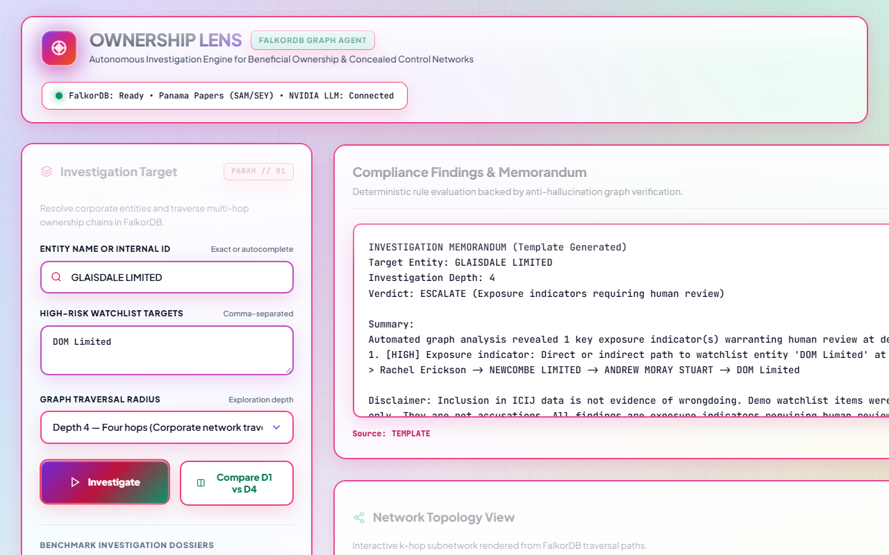
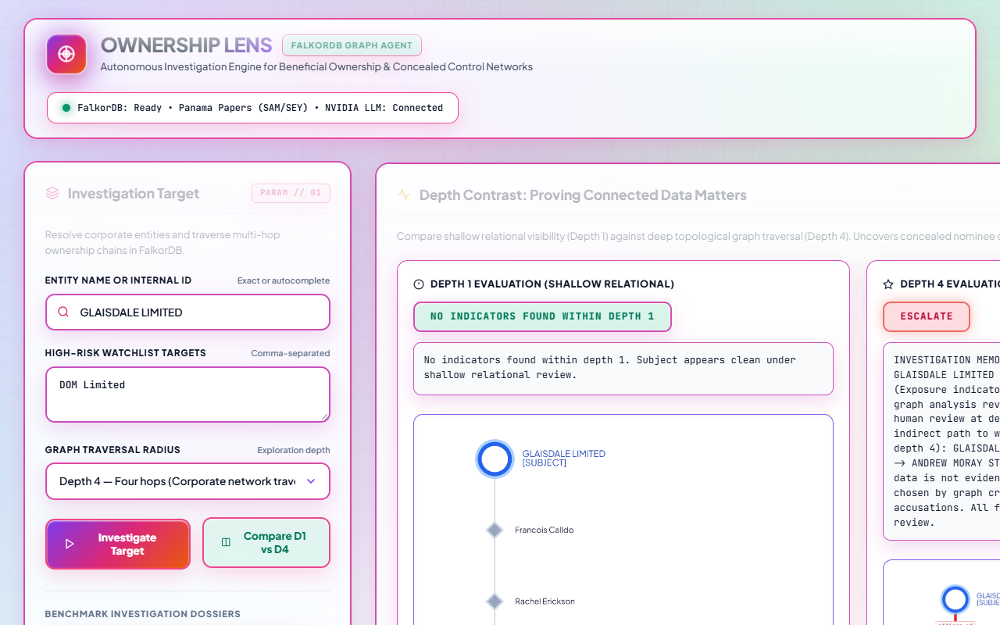
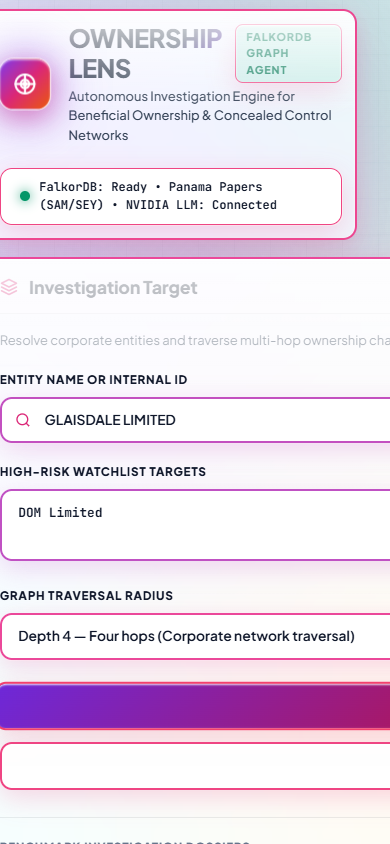

# Demo Runbook & Video Script: Ownership Lens

*3-minute live demonstration script for submission video and live judging.*

---

## Beat 1: Proving the Graph Matters (Depth 1 vs Depth 4 Contrast)

1. Open the UI at `http://localhost:8000` (or the live URL).
2. Enter Target Entity Name: **`GLAISDALE LIMITED`** (or enter node ID `10024477`).
3. Set Watchlist Entities: **`DOM Limited`** (node ID `10189122`).
4. Click **"Compare D1 vs D4"** (or run at Depth 1, then at Depth 4).
5. **Observation**:
   - **Depth 1 Panel**: Verdict is **CLEAR** (`"No exposure indicators found within depth 1"`). The entity has 5 registry links (directors and addresses), but zero watchlist paths exist in 1 hop.
   - **Depth 4 Panel**: Verdict flips to **ESCALATE**!
   - Look at the redesigned Network Topology Graph:
     - A readable **hop-chain text line** above the graph displays the exact path:
       `GLAISDALE LIMITED -[officer of]-> Rachel Erickson -[officer of]-> NEWCOMBE LIMITED -[officer of]-> ANDREW MORAY STUART -[officer of]-> DOM Limited`
     - The path is placed strictly left-to-right (top-to-bottom on mobile) with fixed spacing, preventing label overlaps.
     - Path edges are highlighted in vivid red (`#dc2626`, width 4) with directional arrowheads; path nodes have red borders.
     - `GLAISDALE LIMITED` has a blue focus ring and `[SUBJECT]` tag; `DOM Limited` is filled red with a `[WATCHLIST (demo)]` tag.
     - Direct context nodes are capped at 8 and hidden behind the "Show context" toggle by default.
     - Mass administrative service providers are excluded, with a badge showing `"N more links via service providers (hidden)"`.
     - Clicking any node opens the detail inspector panel displaying its name, type, jurisdiction, node ID, source, and status.

   
   
   

   - **Takeaway**: Relational lookups and shallow 1-hop checks completely miss the risk. Only multi-hop graph traversal through FalkorDB uncovers the hidden control path. This path passes through zero intermediaries and zero mass-address hubs—it is an authentic corporate directorship chain. A degree-matched control cohort of 30 shell companies shows 0.0% connectivity to DOM Limited.

---

## Beat 2: Structural Hubs, Algorithms & The Honest System

1. Enter Target Entity: **`CRYSTAL RISE HOLDINGS LIMITED`** (node ID `10005699`).
2. Select **Depth 2** and click **Investigate**.
3. **Observation**:
   - Watch the live SSE trace stream as tools execute (`resolve_entity`, `ownership_chain`, `shared_links`, `cluster_view`).
   - Notice the trace markers: `via: mcp` and `source: llm`.
   - Verdict: **REVIEW**.
   - Evidence ledger flags `HUB_CENTRALITY`: Computed by FalkorDB `algo.betweenness` in the scratch graph with score $B = 79.0$ (calibrated $\ge 50.0$, 99.5th percentile).
4. Now test negative controls:
   - Enter **`OMNIA TECHNOLOGIES S.A.`** (node ID `10014876`): Verdict is **CLEAR** (multi-link entity with 0 exposure indicators).
   - Enter **`Dewburn Enterprises Inc.`** (node ID `10000280`): Verdict is **INSUFFICIENT_EVIDENCE** (honestly abstains on degree 1 entity < MIN_LINKS=2).
   - Enter an entity not in the graph: **`Ghostly Offshore Unknown Corp XYZ`**: Verdict is **INSUFFICIENT_EVIDENCE** (lists candidate resolutions rather than hallucinating).

---

## Beat 3: Graph Memory and Prior Case Recall

1. Now enter related entity: **`NEWCOMBE LIMITED`** (`node_id: 10028037`).
2. Select **Depth 2** and click **Investigate**.
3. **Observation**:
   - Observe the **"Prior Cases Recalled"** card on the results panel.
   - The earlier decision recorded on `GLAISDALE LIMITED` is recalled automatically via 2-hop graph traversal from `(:Case)-[:ABOUT]->(shared)`.
   - Every verdict is written back into FalkorDB as a `(:Case)` node connected with `[:ABOUT]` and `[:CITED]` edges, making compliance intelligence compound over time.

---

## Voice-Over Script (150 Words — Read Aloud in ~60 Seconds)

> "Welcome to Ownership Lens, an autonomous graph agent built on FalkorDB for Track 1: Agents That Act on Connected Data.
>
> Offshore networks deliberately conceal beneficial ownership behind layers of shell companies and corporate directors. When we examine 'GLAISDALE LIMITED' at depth 1, it appears clear: ordinary filings and zero watchlist exposure.
>
> But when our agent traverses FalkorDB to depth 4, the verdict flips to ESCALATE. The graph uncovers a 4-hop corporate directorship chain through Rachel Erickson and Andrew Stuart directly into defaulted watchlist entity DOM Limited.
>
> The LLM never writes raw Cypher and never invents verdicts. All decisions are computed deterministically by graph algorithms—PageRank, Betweenness, and Shortest Paths—and every memorandum is verified against tool data to eliminate hallucinations.
>
> Each decision is persisted back to FalkorDB as a Case node, allowing future investigations to recall past compliance intelligence. That is connected data in action."

---

## "If It Breaks" Backup Plan (Replay Fallback)

If the live LLM endpoint experiences an unexpected outage during recording:
1. Append `?mode=replay` to the URL or select any of the pre-configured replay demo cards in the UI.
2. The UI automatically displays the verified offline trace, Cytoscape graph layout, evidence ledger, and memo with a clear `"Replay Mode"` indicator badge, ensuring the demo can proceed flawlessly.
